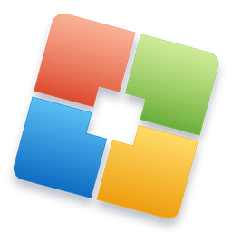
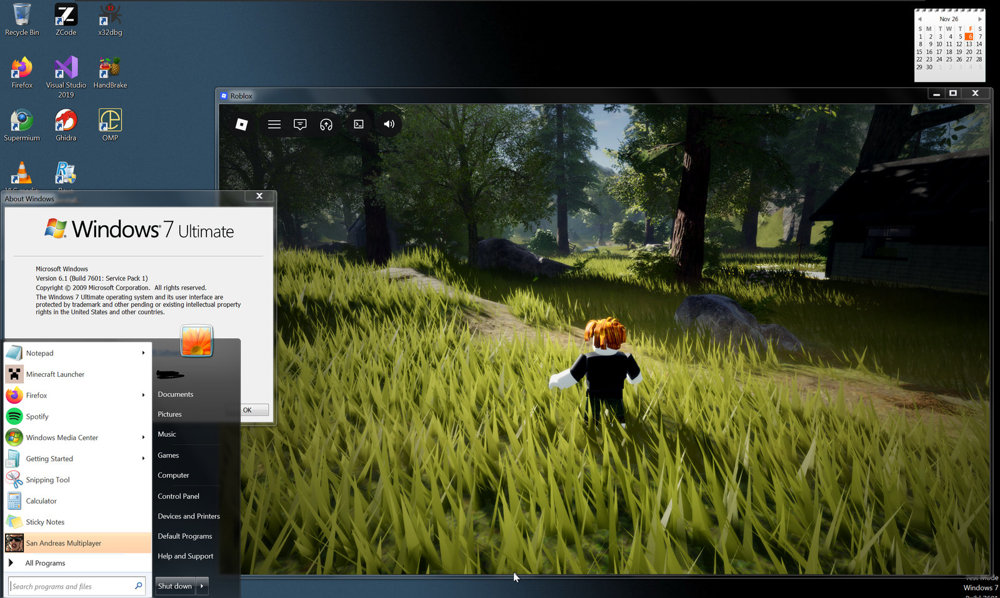
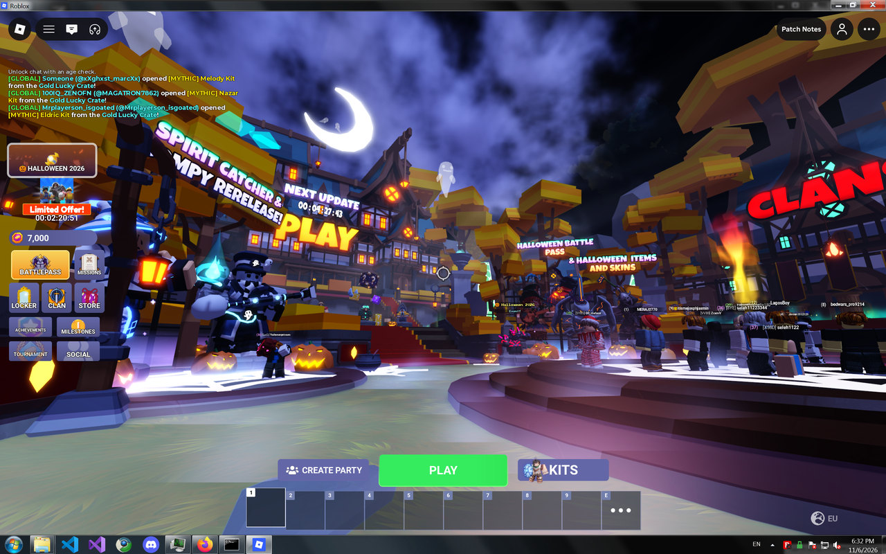
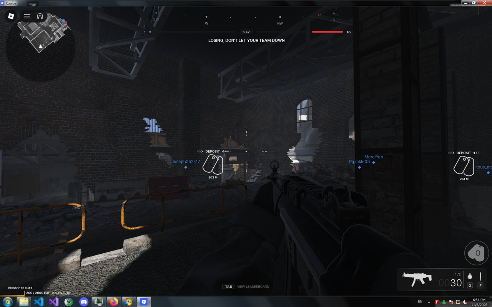
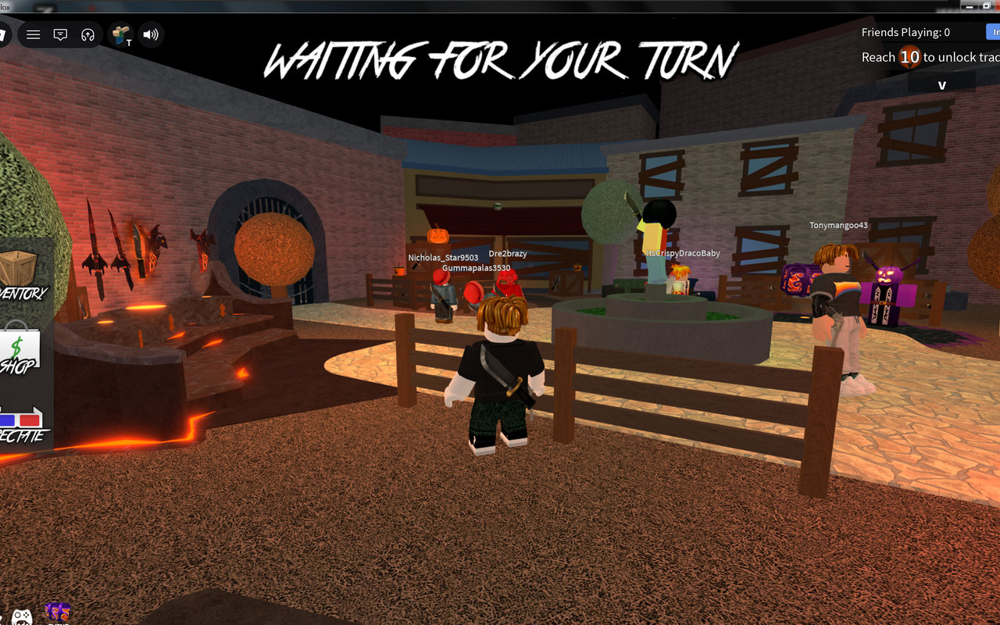
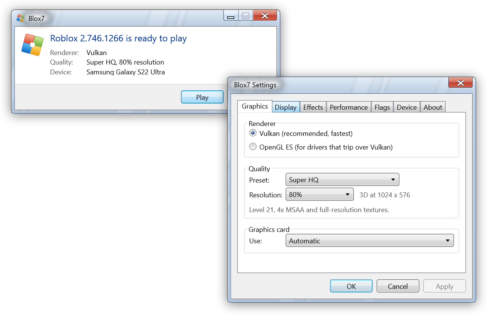
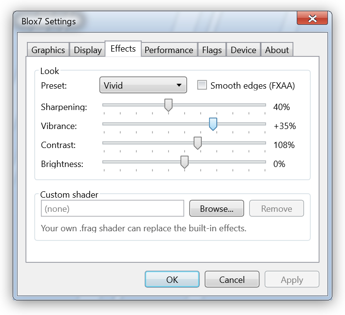
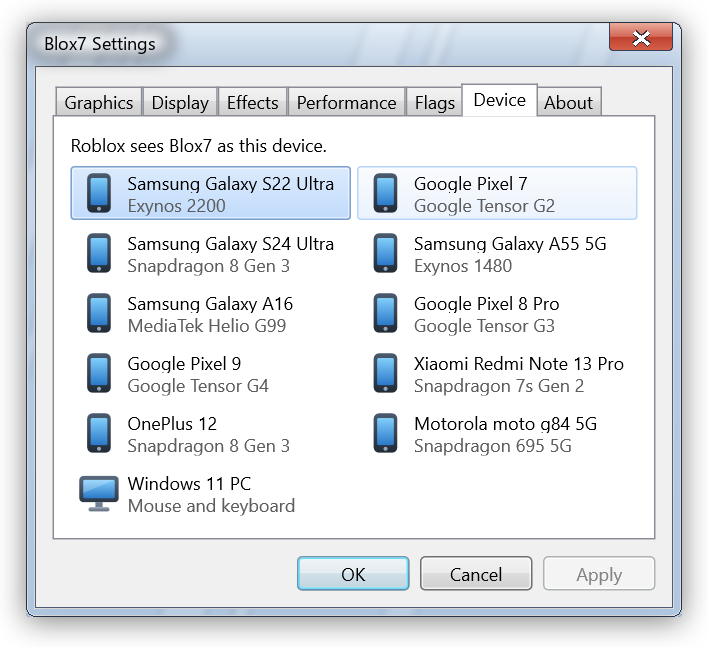
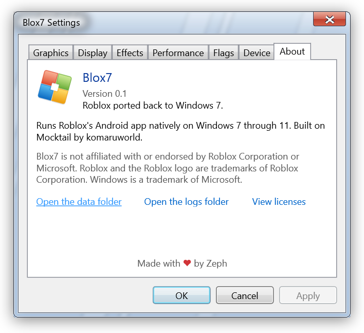
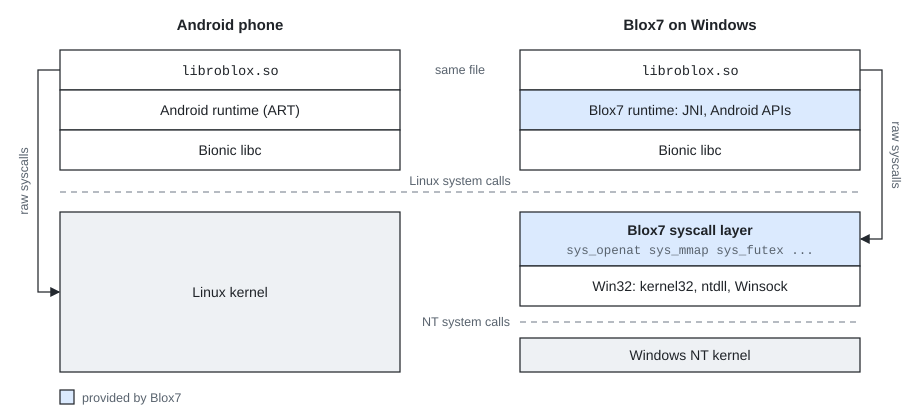

<p align="center">
  
</p>

<h1 align="center">Blox7</h1>

<p align="center">Roblox ported back to Windows 7 through 11.</p>

<p align="center">
  <a href="https://github.com/Zephkek/Blox7/releases/latest"></a>
  
  
  <a href="LICENSE"></a>
</p>

Blox7 is a compatibility layer that runs Roblox's Android client natively on Windows, and is how Windows 7 plays
Roblox again.

<p align="center">
  
</p>

<p align="center">
  
  
  
</p>

## Download

Grab `Blox7.exe` from [Releases](https://github.com/Zephkek/Blox7/releases/latest), run it and press Play. The first
start downloads Roblox (about 150 MB), then you sign in inside the Roblox window.

You need 64-bit Windows 7 SP1 or newer, a Vulkan or OpenGL driver, and WebView2 for signing in (version 109 on
Windows 7).

## The launcher

<p align="center">
  
</p>

<p align="center">
  
  
  
</p>

The launcher looks like it shipped with Windows 7. Its settings let you pick Vulkan or OpenGL, a quality preset up
to Super HQ, a lower render scale for weak GPUs, post effects with your own shaders, fast flags and the phone Roblox
sees.

## How it works

Roblox builds its Android app for x86-64 too, so its code runs straight on a PC's processor. Blox7 gives it the rest
of Android: the same Bionic libc a phone uses, with the Linux kernel underneath swapped for a syscall layer that runs
on Win32 inside the game's process.

<p align="center">
  <picture>
    <source media="(prefers-color-scheme: dark)" srcset="docs/how-it-works-dark.svg">
    
  </picture>
</p>

- Bionic's syscall stubs call functions like `sys_openat` and `sys_futex` instead of the kernel, and each one
  answers the way Linux would.
- The few raw `syscall` instructions inside Roblox are caught with hardware breakpoints and go through the same
  table.
- Graphics, input and audio skip the syscall layer: bridges hand them to the Windows GPU driver and SDL3.

## Building

Blox7 builds on Windows with Python 3, CMake, Ninja, the Android NDK r28c, llvm-mingw, the WebView2 SDK and the
AOSP bionic sources. The tools look in `D:\toolchains` unless `BLOX7_NDK`, `BLOX7_MINGW`, `BLOX7_AOSP`,
`BLOX7_DEPS_SRC` or `BLOX7_WEBVIEW2_SDK` point somewhere else.

<details>
<summary>Build commands</summary>

```bash
python win/tools/deps.py
python win/tools/build.py libc
python win/tools/build.py boot
python win/tools/build.py bridge-sources
python win/tools/build.py bridges
python win/tools/build.py webview
python win/tools/runtime-build.py
python win/tools/build.py blox7
```

</details>

That builds `win/out/release/Blox7.exe`.

## License

Apache 2.0, see [LICENSE](LICENSE). Bundled third-party code keeps its own license. The Android runtime is based
on [Mocktail](https://github.com/komaruworld/mocktail).

Blox7 is not affiliated with Roblox Corporation or Microsoft.

<p align="center">Made with love by Zeph</p>
