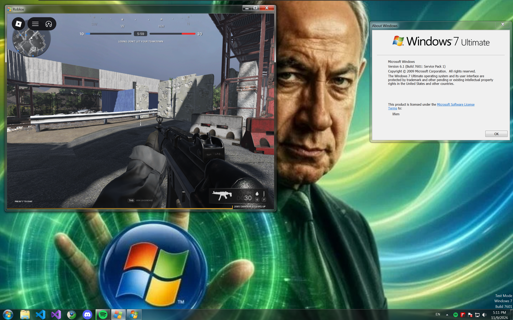

# Blox7

Roblox ended support for Windows 7 and 8.1 in January 2025. Blox7 gets them playing again by running the Android
version of Roblox as an ordinary Windows process. There is no emulator or virtual machine involved, and it works on
Windows 10 and 11 too.

<p align="center">
  
</p>

<p align="center">
  
  
  
</p>

## Download

Get `Blox7.exe` from the [latest release](https://github.com/Zephkek/Blox7/releases/latest), run it and press Play.
The first start downloads Roblox (about 150 MB), then you sign in inside the Roblox window.

You need 64-bit Windows 7 SP1 or newer, a Vulkan or OpenGL driver, and the WebView2 Runtime for the sign-in page.
Windows 7, 8 and 8.1 stop at WebView2 109. If it isn't installed, Blox7 offers to open the download page for it.

## The launcher

<p align="center">
  
</p>

<p align="center">
  
  
  
</p>

The launcher looks like it shipped with Windows 7. In its settings you choose Vulkan or OpenGL ES, a quality preset
up to Super HQ, and a render resolution, which is worth lowering on a weak GPU. The Effects tab has sharpening,
vibrance, contrast and brightness, or takes a `.frag` shader of your own. There are also tabs for fast flags and for
the device Roblox is told it's running on, which can be one of a list of phones or a Windows 11 PC with mouse and
keyboard.

## How it works

Roblox builds its Android app for x86-64 as well as ARM, so its code already runs on a PC's processor. Blox7 gives it
the rest of Android: the same Bionic libc a phone uses, built from the AOSP sources, with the Linux kernel underneath
replaced by a syscall layer that runs on Win32 inside the game's process.

<p align="center">
  <picture>
    <source media="(prefers-color-scheme: dark)" srcset="docs/how-it-works-dark.svg">
    
  </picture>
</p>

Bionic's syscall stubs call functions like `sys_openat` and `sys_futex` instead of the kernel, and each one answers
the way Linux would. Roblox also contains a few raw `syscall` instructions that don't go through libc. Each of those
gets a debug register parked on it, and the exception handler runs the call through the same table.

Graphics, input and audio skip the syscall layer. Bridges pass them to the Windows GPU driver and SDL3.

## Building

The build runs on Windows. It needs Python 3, CMake, Ninja, the Android NDK r28c, llvm-mingw, the WebView2 SDK and
the AOSP bionic sources. The scripts look for these under `D:\toolchains`. Set `BLOX7_NDK`, `BLOX7_MINGW`,
`BLOX7_AOSP`, `BLOX7_DEPS_SRC` or `BLOX7_WEBVIEW2_SDK` if yours are somewhere else.

```bash
python win/tools/deps.py
python win/tools/build.py libc
python win/tools/build.py boot
python win/tools/build.py bridge-sources
python win/tools/build.py bridges
python win/tools/build.py webview
python win/tools/runtime-build.py
python win/tools/build.py blox7
```

Run them in that order. The last one writes `win/out/release/Blox7.exe`.

## License

Apache 2.0, see [LICENSE](LICENSE). Bundled third-party code keeps its own license. The Android runtime is based
on [Mocktail](https://github.com/komaruworld/mocktail).

Blox7 is not affiliated with Roblox Corporation or Microsoft.
