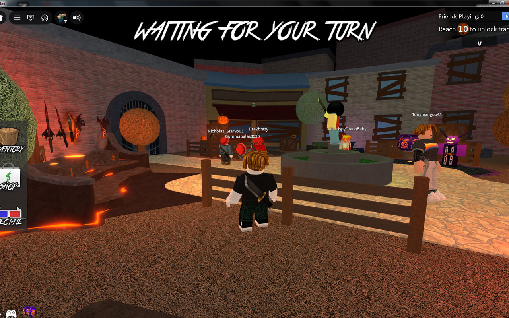
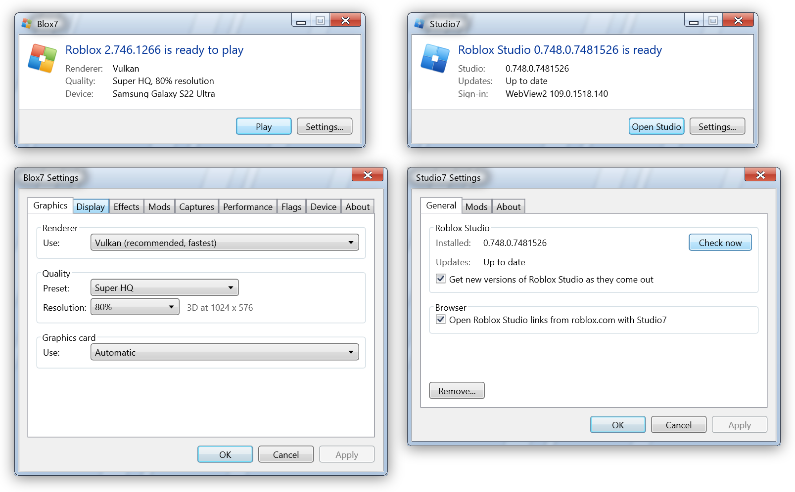
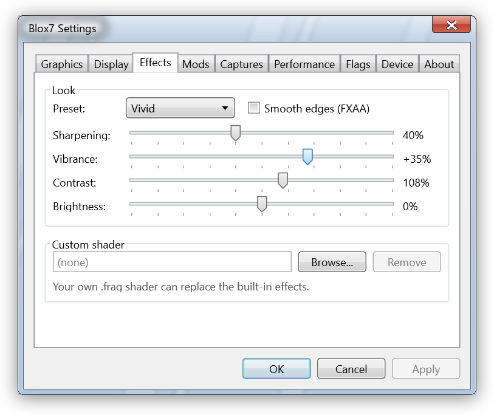
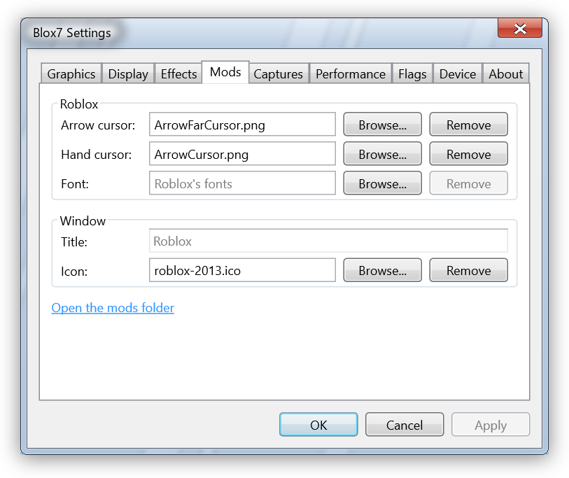

<p>
  
  
</p>

# Blox7 and Studio7

Roblox ended support for Windows 7 and 8.1 in January 2025. Blox7 gets them playing again by running the Android
version of Roblox as an ordinary Windows process. There is no emulator or virtual machine involved, and it works on
Windows 10 and 11 too.

<p align="center">
  
</p>

<p align="center">
  
  
  
</p>

Studio7 is the second program here, and it runs Roblox Studio on Windows 7, 8 and 8.1.

<p align="center">
  
</p>

## Download

Both are on the [latest release](https://github.com/Zephkek/Blox7/releases/latest) page, one exe each. You only need
to download them once, they update themselves.

Run `Blox7.exe` and press Play. The first start downloads Roblox (about 150 MB), then you sign in inside the Roblox
window. It needs 64-bit Windows 7 SP1 or newer and a Vulkan or OpenGL driver.

Run `Studio7.exe` and press Install. It downloads Roblox Studio (about 570 MB). It needs 64-bit Windows 7 SP1, 8 or 8.1.
Windows 10 and 11 don't need it.

Both need the WebView2 Runtime for the sign-in page. Windows 7, 8 and 8.1 stop at WebView2 109.

## The launchers

<p align="center">
  
</p>

<p align="center">
  
  
  
</p>

## Building

The build runs on Windows. Blox7 needs Python 3, CMake, Ninja, the Android NDK r28c, llvm-mingw, the WebView2 SDK
and the AOSP bionic sources. The scripts look for these under `D:\toolchains`. Set `BLOX7_NDK`, `BLOX7_MINGW`,
`BLOX7_AOSP`, `BLOX7_DEPS_SRC` or `BLOX7_WEBVIEW2_SDK` if yours are somewhere else.

```bash
python win/tools/deps.py
python win/tools/build.py libc
python win/tools/build.py boot
python win/tools/build.py bridge-sources
python win/tools/build.py bridges
python win/tools/build.py webview
python win/tools/runtime-build.py
python win/tools/build.py blox7
```

Run them in that order. The last one writes `win/out/release/Blox7.exe` and needs the BearSSL 0.6 sources in
`bearssl` under `BLOX7_DEPS_SRC`.

Studio7 is one step and doesn't need any of the steps above. It only needs llvm-mingw and, under `BLOX7_DEPS_SRC`,
the zlib sources in `zlib` and BearSSL 0.6 in `bearssl`.

```bash
python win/tools/build.py studio7
```

That writes `win/out/release/Studio7.exe`.

## License

Copyright 2026 Zeph, Apache 2.0, see [LICENSE](LICENSE). If you ship something with Blox7 or Studio7 code in it, the
[NOTICE](NOTICE) text and the copyright lines have to go with it, that's section 4 of the license. Bundled third-party
code keeps its own license. Blox7's Android runtime is based on [Mocktail](https://github.com/komaruworld/mocktail).

Blox7 and Studio7 are not affiliated with Roblox Corporation or Microsoft.
