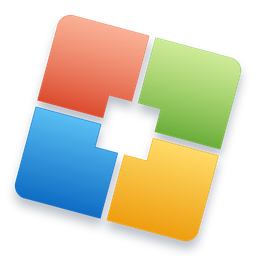
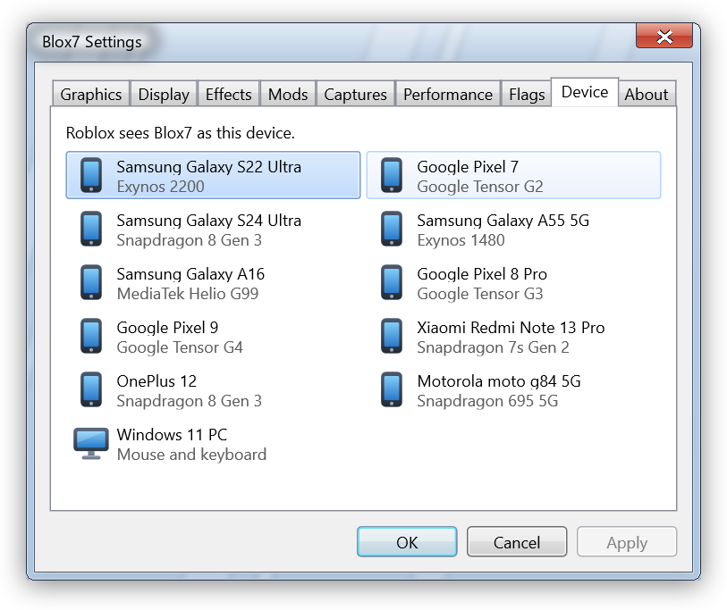

<p>
  
  
</p>

# Blox7 and Studio7

Roblox ended support for Windows 7 and 8.1 in January 2025. Blox7 gets them playing again by running the Android
version of Roblox as an ordinary Windows process. There is no emulator or virtual machine involved, and it works on
Windows 10 and 11 too. Studio7 is the second program here, and it runs Roblox Studio on Windows 7.

<p align="center">
  
</p>

<p align="center">
  
  
  
</p>

Roblox Studio wants Windows 10 as well, and on Windows 7 it doesn't start on its own. Studio7 downloads the same
Studio that Windows 10 and 11 get and fills in the functions Windows 7 is missing.

<p align="center">
  
</p>

## Download

Both are on the [latest release](https://github.com/Zephkek/Blox7/releases/latest) page, one exe each.

Run `Blox7.exe` and press Play. The first start downloads Roblox (about 150 MB), then you sign in inside the Roblox
window. It needs 64-bit Windows 7 SP1 or newer and a Vulkan or OpenGL driver.

Run `Studio7.exe` and press Install. It downloads Roblox Studio from Roblox (about 570 MB), and from then on Open
Studio starts it. It needs 64-bit Windows 7 SP1. Windows 8 and 8.1 aren't supported yet, and Windows 10 and 11
don't need it.

Both need the WebView2 Runtime for the sign-in page. Windows 7, 8 and 8.1 stop at WebView2 109. If it isn't
installed, Blox7 offers to open the download page for it and Studio7 shows a link.

You only need to download each exe once. When a launcher opens it asks GitHub whether a newer one has been published
here. If so it downloads it, checks it against the SHA-256 that GitHub lists for the file, puts it in its own place
and starts it. If the settings are open or Roblox is running it doesn't restart, and the new exe is used from the
next start. Each About page has a box that turns this off.

## The launchers

<p align="center">
  
</p>

<p align="center">
  
  
  
</p>

Both launchers look like they shipped with Windows 7. In Blox7's settings you choose Vulkan or OpenGL ES, a quality
preset up to Super HQ, and a render resolution, which is worth lowering on a weak GPU. The Effects tab has
sharpening, vibrance, contrast and brightness, or takes a `.frag` shader of your own. The Mods tab takes your own
cursors, font, window title and icon. Captures sets how videos are recorded and where they and screenshots are
saved. There are also tabs for fast flags and for the device Roblox is told it's running on, which can be one of a
list of phones or a Windows 11 PC with mouse and keyboard.

Studio7 has less to set. Each time you open it, it looks for a newer Studio and downloads it, unless you turn that
off. The new version goes next to the one you have and is used from the next start, so an open Studio is never
replaced. If the new one closes right after starting, Studio7 goes back to the one that worked. Its files are all
in `%LOCALAPPDATA%\Studio7`, and the Remove button takes them away again.

It has a Mods tab as well, for your own arrow and hand cursors, a font for Studio's toolbar and a window icon. There
is also a mods folder, laid out like Studio's own folder, and a picture, font or sound in it replaces the file
Studio has in the same place. Studio's own files are kept, and they come back when you take a mod out. Remove
leaves the mods folder alone if there is anything in it.

## How it works

### Blox7

Roblox builds its Android app for x86-64 as well as ARM, so `libroblox.so` already runs on a PC's processor. What it
needs is the rest of Android around it, and Blox7 provides that inside a normal Windows process.

<p align="center">
  <picture>
    <source media="(prefers-color-scheme: dark)" srcset="docs/how-it-works-dark.png">
    
  </picture>
</p>

The C library is Bionic, the same one a phone uses, built from the AOSP sources. Its syscall stubs don't enter a
kernel. They call functions like `sys_openat` and `sys_futex` in Blox7's syscall layer, which do the work with Win32
and answer the way Linux would.

Roblox also contains a few raw `syscall` instructions that don't go through libc. Each of those gets a debug register
parked on it, and the exception handler runs the call through the same table.

Roblox's Java code never runs. Its native code still calls into Java through JNI, and Blox7's JNI VM answers those
calls in C++.

Graphics, input and audio skip the syscall layer. The Android libraries Roblox links against, like `libEGL.so` and
`libvulkan.so`, are Blox7's own, and bridges pass their calls to SDL3 and the Windows GPU driver.

### Studio7

Studio is an ordinary Windows program, so none of the Android machinery is involved. What stops it on Windows 7 is
about forty functions it imports that only came with Windows 8 and 10, like `WaitOnAddress` and
`GetSystemTimePreciseAsFileTime`.

Studio7 carries six small DLLs that stand in for `kernel32.dll`, `user32.dll`, `ws2_32.dll` and a few others. They
pass the functions Windows 7 already has on to the real DLLs and implement the missing ones themselves. After the
download Studio7 writes their names into the import tables of the files that need them. In the current version that
is eleven names in six files, and each one is noted so it can be put back byte for byte.

Studio also asks for some functions under API-set DLL names that Windows 7 doesn't know, and for those Studio7
writes small DLLs that only forward.

A few functions that Windows 7 does have are answered by these DLLs too. Studio's video recorder asks the H.264
encoder for its attribute store, the Windows 7 encoder says it has none, and Studio stops there. Studio7 wraps the
encoder and hands it one, and recording works. That encoder doesn't take frames larger than 1920x1088. The window
icon from the Mods tab goes the same way: Qt gives its windows the icon from Studio's exe, and the `user32.dll`
stand-in puts yours there instead.

## Building

The build runs on Windows. Blox7 needs Python 3, CMake, Ninja, the Android NDK r28c, llvm-mingw, the WebView2 SDK
and the AOSP bionic sources. The scripts look for these under `D:\toolchains`. Set `BLOX7_NDK`, `BLOX7_MINGW`,
`BLOX7_AOSP`, `BLOX7_DEPS_SRC` or `BLOX7_WEBVIEW2_SDK` if yours are somewhere else.

```bash
python win/tools/deps.py
python win/tools/build.py libc
python win/tools/build.py boot
python win/tools/build.py bridge-sources
python win/tools/build.py bridges
python win/tools/build.py webview
python win/tools/runtime-build.py
python win/tools/build.py blox7
```

Run them in that order. The last one writes `win/out/release/Blox7.exe`. It also compiles BearSSL 0.6 into the
launcher for the update check, and looks for its sources in `bearssl` under `BLOX7_DEPS_SRC`.

Studio7 is one step and doesn't need any of the steps above. It only needs llvm-mingw and, under `BLOX7_DEPS_SRC`,
the zlib sources in `zlib` and BearSSL 0.6 in `bearssl`.

```bash
python win/tools/build.py studio7
```

That writes `win/out/release/Studio7.exe`.

## License

Apache 2.0, see [LICENSE](LICENSE). Bundled third-party code keeps its own license. Blox7's Android runtime is based
on [Mocktail](https://github.com/komaruworld/mocktail).

Blox7 and Studio7 are not affiliated with Roblox Corporation or Microsoft.
