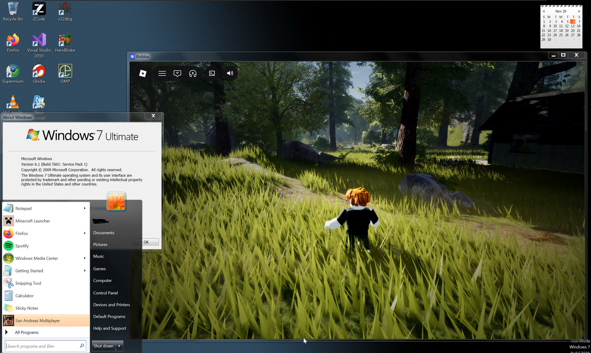
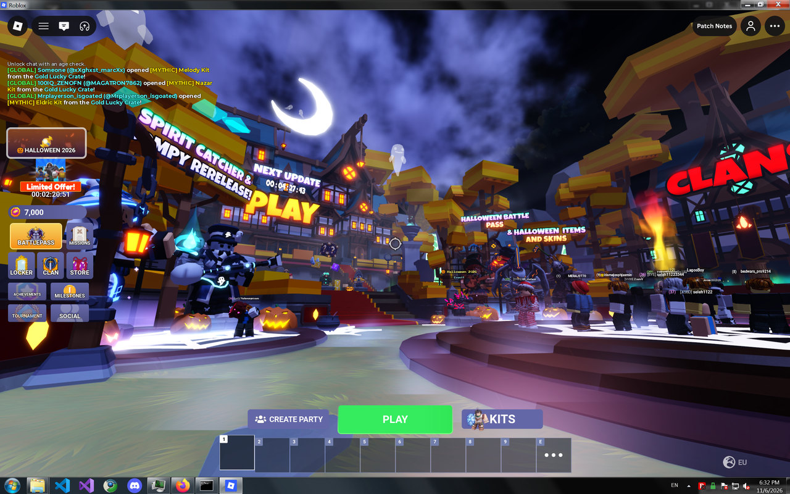
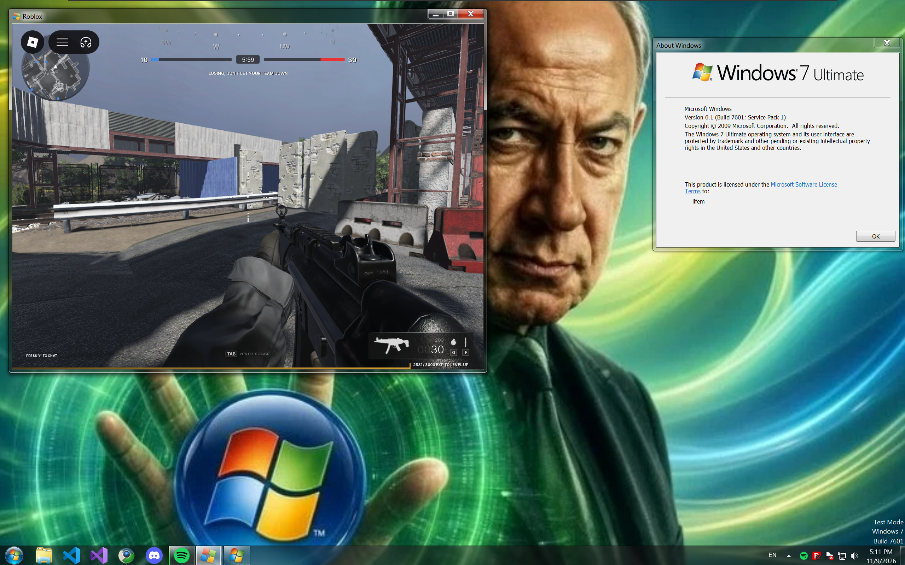
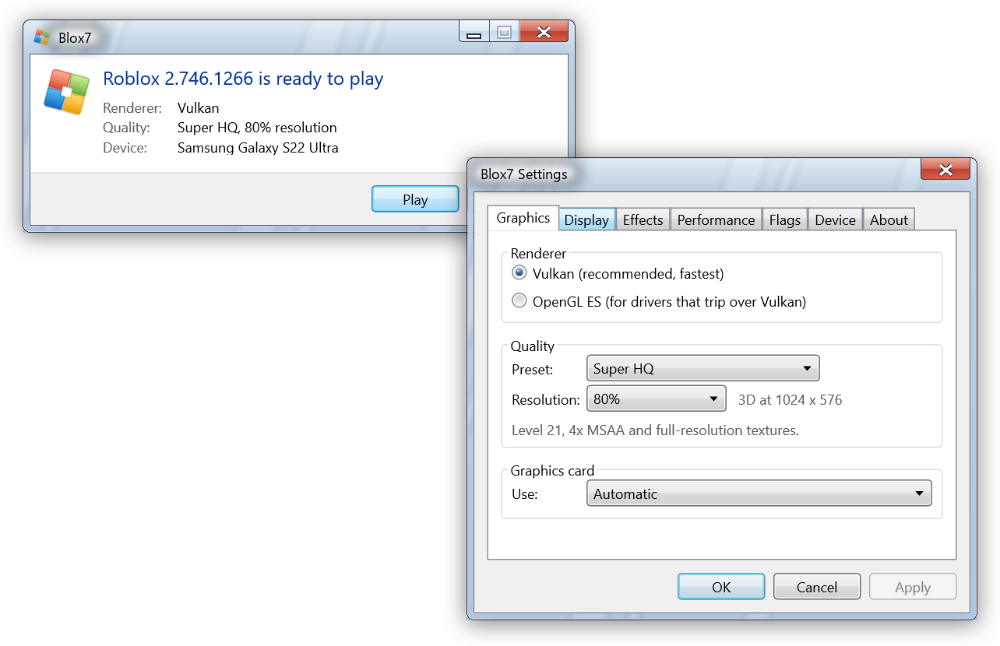
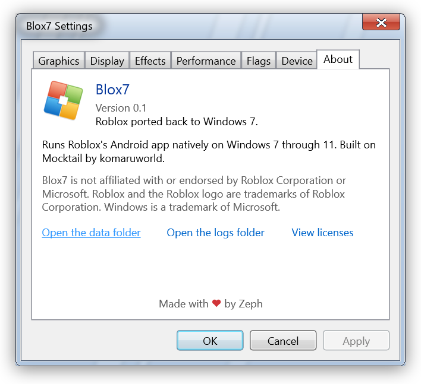
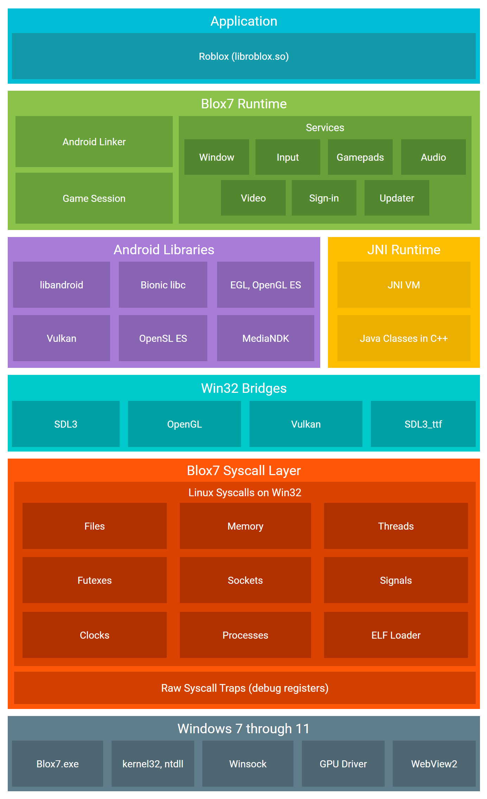
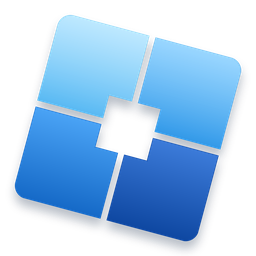
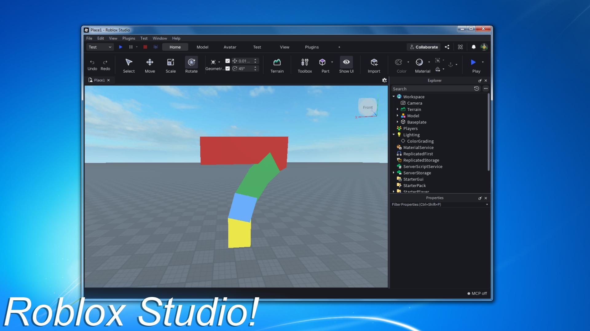
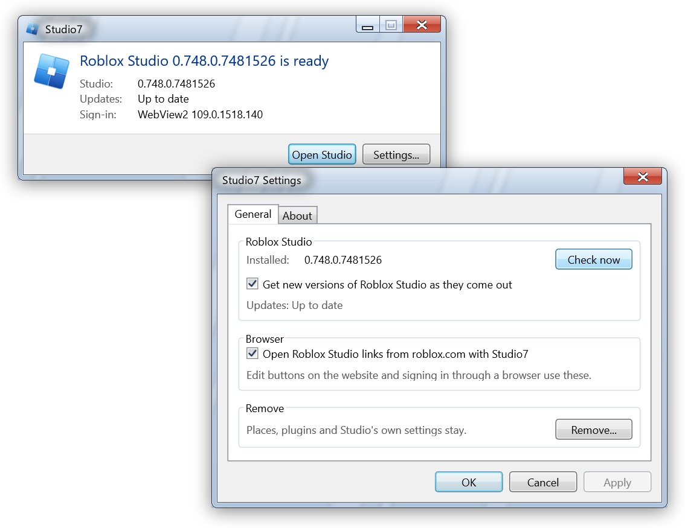

# Blox7

Roblox ended support for Windows 7 and 8.1 in January 2025. Blox7 gets them playing again by running the Android
version of Roblox as an ordinary Windows process. There is no emulator or virtual machine involved, and it works on
Windows 10 and 11 too.

Roblox Studio wants Windows 10 as well. [Studio7](#studio7), further down, runs it on Windows 7.

<p align="center">
  
</p>

<p align="center">
  
  
  
</p>

## Download

Get `Blox7.exe` from the [latest release](https://github.com/Zephkek/Blox7/releases/latest), run it and press Play.
The first start downloads Roblox (about 150 MB), then you sign in inside the Roblox window.

You need 64-bit Windows 7 SP1 or newer, a Vulkan or OpenGL driver, and the WebView2 Runtime for the sign-in page.
Windows 7, 8 and 8.1 stop at WebView2 109. If it isn't installed, Blox7 offers to open the download page for it.

## The launcher

<p align="center">
  
</p>

<p align="center">
  
  
  
</p>

The launcher looks like it shipped with Windows 7. In its settings you choose Vulkan or OpenGL ES, a quality preset
up to Super HQ, and a render resolution, which is worth lowering on a weak GPU. The Effects tab has sharpening,
vibrance, contrast and brightness, or takes a `.frag` shader of your own. There are also tabs for fast flags and for
the device Roblox is told it's running on, which can be one of a list of phones or a Windows 11 PC with mouse and
keyboard.

## How it works

Roblox builds its Android app for x86-64 as well as ARM, so `libroblox.so` already runs on a PC's processor. What it
needs is the rest of Android around it, and Blox7 provides that inside a normal Windows process.

<p align="center">
  <picture>
    <source media="(prefers-color-scheme: dark)" srcset="docs/how-it-works-dark.png">
    
  </picture>
</p>

The C library is Bionic, the same one a phone uses, built from the AOSP sources. Its syscall stubs don't enter a
kernel. They call functions like `sys_openat` and `sys_futex` in Blox7's syscall layer, which do the work with Win32
and answer the way Linux would.

Roblox also contains a few raw `syscall` instructions that don't go through libc. Each of those gets a debug register
parked on it, and the exception handler runs the call through the same table.

Roblox's Java code never runs. Its native code still calls into Java through JNI, and Blox7's JNI VM answers those
calls in C++.

Graphics, input and audio skip the syscall layer. The Android libraries Roblox links against, like `libEGL.so` and
`libvulkan.so`, are Blox7's own, and bridges pass their calls to SDL3 and the Windows GPU driver.



## Studio7

<p align="center">
  
</p>

Studio7 is a second program in this repo. It runs the current Roblox Studio on Windows 7, where Studio on its own
doesn't start.

Get `Studio7.exe` from the [latest release](https://github.com/Zephkek/Blox7/releases/latest), run it and press
Install. It downloads Roblox Studio from Roblox (about 570 MB), and from then on Open Studio starts it. You sign in
inside Studio, which needs the WebView2 Runtime. If that is missing Studio7 says so and links to version 109, the
last one for Windows 7. Studio7 needs 64-bit Windows 7 SP1. Windows 8 and 8.1 aren't supported yet.

<p align="center">
  
</p>

New versions of Studio are downloaded next to the one you have and used from the next start, so an open Studio is
never replaced. If a new version closes right after starting, Studio7 goes back to the one that worked. Its files
are all in `%LOCALAPPDATA%\Studio7`, and the Remove button in the settings takes them away again.

Studio is an ordinary Windows program, so none of the Android machinery above is involved. What stops it on
Windows 7 is about forty functions it imports that only came with Windows 8 and 10, like `WaitOnAddress` and
`GetSystemTimePreciseAsFileTime`. Studio7 carries six small DLLs that stand in for `kernel32.dll`, `user32.dll`,
`ws2_32.dll` and a few others. They pass the functions Windows 7 already has on to the real DLLs and implement the
missing ones themselves. After the download Studio7 writes their names into the import tables of the files that
need them. In the current version that is ten names in five files, and each one is noted so it can be put back
byte for byte. Studio also asks for some functions under API-set DLL names that Windows 7 doesn't know, and for
those Studio7 writes small DLLs that only forward.

## Building

The build runs on Windows. It needs Python 3, CMake, Ninja, the Android NDK r28c, llvm-mingw, the WebView2 SDK and
the AOSP bionic sources. The scripts look for these under `D:\toolchains`. Set `BLOX7_NDK`, `BLOX7_MINGW`,
`BLOX7_AOSP`, `BLOX7_DEPS_SRC` or `BLOX7_WEBVIEW2_SDK` if yours are somewhere else.

```bash
python win/tools/deps.py
python win/tools/build.py libc
python win/tools/build.py boot
python win/tools/build.py bridge-sources
python win/tools/build.py bridges
python win/tools/build.py webview
python win/tools/runtime-build.py
python win/tools/build.py blox7
```

Run them in that order. The last one writes `win/out/release/Blox7.exe`.

Studio7 builds on its own with `python win/tools/build.py studio7`. It only needs llvm-mingw and, under
`BLOX7_DEPS_SRC`, the zlib sources in `zlib` and BearSSL 0.6 in `bearssl`. It writes `win/out/release/Studio7.exe`.

## License

Apache 2.0, see [LICENSE](LICENSE). Bundled third-party code keeps its own license. The Android runtime is based
on [Mocktail](https://github.com/komaruworld/mocktail).

Blox7 is not affiliated with Roblox Corporation or Microsoft.
